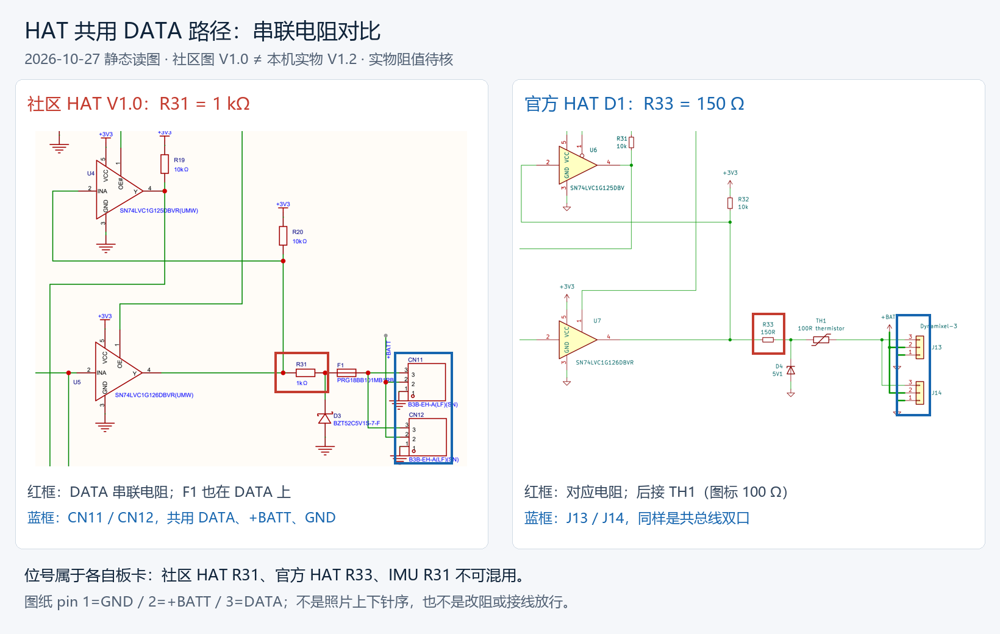

# HAT 双 3P 口接入舵机后 IMU 缺答：原理图复核

日期：2026-10-27（北京时间）。范围：用户反馈 IMU 与舵机链各占 HAT 一个 3P 口，舵机接入时 IMU 几乎无应答、拔掉舵机端子后恢复；核对是否存在双口冲突或设计缺陷。本轮只读原理图、厂商资料、已归档照片及既有实验数据，未连接主控、停服务、发总线请求、接线、上电或改阻。

## 结论

1. **[原理图] 存档社区 HAT V1.0 图的两个口是同一条总线的并联接点，不是两路独立 UART／收发器。** 图中不存在“两个口各自的发送芯片互相顶住”的结构；两个口不提供支路隔离。
2. **[原理图] 社区 HAT 的 DATA 串联 R31=1 kΩ，官方 HAT 对应 R33=150 Ω。** 比较的是同一功能位置，不能按相同位号比较。社区这颗电阻约大 6.67 倍；这是电阻本体比值，不能当作总输出阻抗、压降或丢包率比值。
3. **[原理图推断] 这一路采用 TX 电平自动换向，高位释放、靠上拉恢复。** **[假设]** 大串联阻抗与并联上拉/线缆负载可能导致电平或时序余量不足；尚未测量本机波形与实装阻值，供电/地、异常节点和固件响应仍为替代解释，不能归结为已验证缺陷。
4. **[照片确认／待核] 本机丝印 V1.2；现有社区图是 V1.0。** 既有照片不能读出对应电阻实际阻值，尚未取得 V1.2 PCB/网表/贴装 BOM。后续沿用户提供的 ScrapMeta 地址取得官方 C1 工程，但它仍只是参考版，见[PCB 来源检索](#pcb-source-search-20261027)。
5. **[本机既有实测] 接入整条舵机支路会使 IMU 应答成功率严重下降。** 整个 3P 插拔同时改变 DATA、+BATT 负载和 GND 路径；尚未独立测量 IMU 接收端波形/电源，也未观察从机发送。因此还不能断言故障一定发生在 IMU 接收方向，或已完全排除供电/地、异常节点与固件对畸变信号的反应。



## 原理图逐网核对

依据：用户归档的 [V1.0 原 PDF](../../schematics/microduck-hat-v1.0-sch/SCH_Microduck-Hat-for-Radxa-Zero_2026-10-06.pdf)，第 4/5 页 `Servo`，创建 2026-09-03、更新 2026-09-20；本轮目视核对完整页面和[局部放大](hat-servo-crop.png)，不只依赖文字提取。

| 项目 | V1.0 图中实际连接 | 含义 |
|---|---|---|
| CN11 / CN12 pin 3 | 两者直接同网，接 F1 的接口侧 | 两口不会分开调度，也无独立缓冲；一支路的负载会影响另一支路 |
| CN11 / CN12 pin 2 | 共接 +BATT | 接入舵机会改变公共电源负载；不经 F1 |
| CN11 / CN12 pin 1 | 共接 GND | 存在共同参考地和回流路径 |
| U5 SN74LVC1G126 pin 4 | 接内部 DATA 节点 A | 主控发送缓冲 |
| R31 | A → 1 kΩ → 节点 B | 共用 DATA 的串联电阻；不是上拉、不是某一个口的专属电阻 |
| D3 BZT52C5V1S-7-F | 节点 B 对地 | 数据保护支路；不是电源稳压输出 |
| F1 PRG18BB101MB1RB | B → F1 → 外部 DATA 节点 C | 位于两口分支之前的数据路径；不是舵机动力保险 |
| R20=10 kΩ | +3V3 → A | 数据上拉，位于 R31 的内部侧 |
| U4 SN74LVC1G125 | A → 接收缓冲 → U7 与门 → UART2_RX | HAT 接收方向也经这套共用接口；R19 是 U4 输出侧上拉，不是直接外部总线上拉 |
| Q2 / TTL_TXEN | UART2_TX 经 R16 驱动 PNP，R17 下拉 TTL_TXEN；该信号同时控制 U4 / U5 | 用 TX 电平自动换向，非两个口分别控制 |

简化连接（节点 A/B/C 仅为本轮解释所起的名字）：

```text
+3V3 -- R20 10k -- A -- R31 1k -- B -- F1 -- C -- CN11 pin3（DATA）
                 |              |            `-- CN12 pin3（DATA）
                 |              D3
                 |              GND
                 +-- U4 接收缓冲 → U7 → UART2_RX
                 `-- U5 发送缓冲 ← UART2_TX
```

针脚编号是原理图符号编号，不是照片的上下位置。旁边 U8/U9 是 4P RS485 接口，不是另两路 TTL 输出。本轮没有将 4P 口作为替换方案。

## 官方原图对照与版本边界

本轮经 GitHub 官方仓库 API 取得树与源文件，固定到 `pollen-robotics/elec_RPI_Robot_HAT @ 6de86283297e4c49a9da8312cd3395ab83c437e3`：

- [官方生产 PDF](sources/upstream-hat-D1.pdf)：文件名 `ASE01187-D1_elec_RPI_Robot_HAT_SCH.pdf`；封面 D1/2026-10-06。所用电路页是第 4/6 页 `Dynamixel`，该子页标题栏仍标 B1/2026-05-06，不能把封面修订当作每个子页修订。
- [官方 KiCad 电路源文件](sources/upstream-dynamixel.kicad_sch)：同一固定提交的 `dynamixel.kicad_sch`，直接核到 `Reference=R33, Value=150R`，与 PDF 一致。
- 原始来源 URL、下载状态、SHA256 见 [source-manifest.json](source-manifest.json)。仅下载到本项目调研目录，没有同步/修改任何只读参考库，也未向 Git 远端拉取。

| 功能位置 | 社区 HAT V1.0 | 官方 HAT 上述固定版本 |
|---|---|---|
| DATA 串联电阻 | **R31=1 kΩ** | **R33=150 Ω** |
| 串联保护件 | F1=PRG18BB101MB1RB，实物/本次厂商阻值未核准 | TH1，图标 `100R thermistor` |
| 数据节点上拉 | R20=10 kΩ | R32=10 kΩ |
| 发送缓冲 | U5 / 1G126 | U7 / 1G126 |
| 接收缓冲 | U4 / 1G125 | U6 / 1G125 |
| TTL 接口 | CN11 / CN12 共总线 | J13 / J14 共总线 |

[原理图推断] 两个连接点共网本身不等于两路发送器冲突；也不能因此认定官方版本已验证适配本机 15 颗飞特 + GD32 IMU。两份图在串联阻值上存在差异，但这次快照不足以确定改动历史、动机或社区 V1.2 沿用情况。

## 为什么没有舵机应答也可能出问题

### 自动换向与电平余量

依据 Q2 连线以及 1G125/126 真值表：

| UART2_TX | TTL_TXEN 稳态 | U5 发送 | U4 接收 |
|---|---|---|---|
| 低 | 高 | 使能，输出低 | 禁止、高阻，R19 拉高其输出 |
| 高（含空闲） | 低 | 高阻释放 | 使能，跟随 DATA |

这是电路稳态推导，不是示波器测量；Q2 与逻辑门传播延迟、开关过渡并未量化。高位不是 U5 持续强推，主要由上拉恢复。多从站的上拉即使在不发包时仍可能存在，且低位驱动需要克服这些上拉。

**低位电平示例（不是实测）：** 将外部所有上拉简化为同一 3.3V 源、合成电阻 `Rp=2 kΩ`，发送器低位理想为 0V，先忽略 F1、驱动内阻和其他支路，则接口低位约为：

`Vlow = 3.3 × Rseries / (Rp + Rseries)`

- Rseries=1 kΩ 时，Vlow≈1.10V；
- Rseries=150 Ω 时，Vlow≈0.23V。

这里的 Rp 是说明机理的假设，不是 HD-1910 的实测上拉，更不能反推每颗舵机阻值。它说明大串联阻抗可能使“0”拉不够低；不同供电域上拉、器件内阻、F1 温度/阻值和线损都会改变结果。

TI 的 [SN74LVC1G125](sources/sn74lvc1g125-ti.pdf) 第 5 页 §5.3 给出 3–3.6V 供电时保证识别低位的输入上限 0.8V、高位下限 2.0V；0.8–2.0V 不属于保证的逻辑区间。这不是芯片的精确翻转阈值。手头 HAT 图标 `(UMW)`，IMU 也需核具体贴装厂商；TI 手册用于同型号参考，不等于已核实本机器件。126 相应范围与真值表见 [TI 资料](sources/sn74lvc1g126-ti.pdf) 第 5、11 页。

### 电容、边沿与分支

1 Mbps 的一位是 1µs。举例将一段路径近似为一阶 RC，假定 C=500pF，则该串阻单独贡献的 10%–90% 阶跃时间量级 `2.2RC`：1 kΩ 为 1.10µs，150 Ω 为 0.165µs。**不是实物 C 测量，也不是当前电路完整的上升沿预测**：高位恢复还受 R20/从站并联上拉、分布支路、钳位电容等影响，实际应求整个网络或直接看波形。

因此，舵机挂线既可能加大电容/改变反射，也可能增强上拉——强上拉可能加快上升，却同时增大发送低位负担。“舵机越多一定上升越慢”“只改 IMU R5 就必好”都不能由现有资料推出。

**HAT 原理图中的 R31 与 IMU 板上的 R31 是两颗不同电阻。** jyg9 [2026-09-30 原始提交](sources/imu-hardware-fix-1d910b5.json) `1d910b5a82c6` 的说明是优化飞特上拉过小所致丢包；改的是 **IMU R31 上拉 10k→100k、IMU R5 串联 100Ω→51Ω**。本地参考 PCB 已含此修改，但成品贴装批次未知。见[先前原始网络提取](../microduck-imu-community-20261026/local-resistor-check.json)。这给共线电气交互提供同源线索，不能直接等同本机根因。

## 本机证据及不能跨越的推论

以下为复核既有日志，不是本轮新测试：

| 条件 | 单 ID 200 连续查询结果 | 来源／证据等级 |
|---|---|---|
| IMU 在 HAT 一口，15 颗舵机支路在另一口；只请求 200 | 6/475=1.26%；469 timeout、0 bad_id、0 bad_checksum | [原始 JSON](../servo-web-imu-3d-20261024/imu-poll-exp-20261027.json)，本机历史实测 |
| 拔掉整条舵机 3P，仅保留同口 IMU | 500/500=100%；0 错误 | [原始 JSON](../servo-web-imu-3d-20261024/imu-poll-exp-20261027-servo-off.json)，本机历史实测 |
| 只接 1 颗或 3 颗舵机 | 并行更新的进度/续 10 记录为混读全员 500/500 | [PROGRESS](../../../PROGRESS.md)与[主记录续 10](../servo-web-imu-3d-20261024/research.md)，本轮未找到对应独立原始数据文件，不升级证据等级 |
| 双口并存时用户观察 IMU 完全收不到；拔舵机恢复 | 定性复现 | 本轮用户反馈；不将特定观察窗的 0 答覆盖成所有条件 100% 丢包 |

[原实验脚本](../../../scripts/imu-poll-exp-20261027.py) 的单 ID 步骤使用 `sync_read([200],56,15)`。这显著削弱“必须有舵机正常应答流量才触发”的解释；但主机 `bad_id=0` 只能说明未记录到错 ID 的有效应答，不能证明模拟总线没有畸变字节、异常驱动或未被解析器接受的流量。

尚未确定：请求到不了 IMU、IMU 解码失败、IMU 已应答但回包到不了主控，还是电源/地改变诱发异常。此前 CRC 错答支持请求/接收方向受损的可能性，但跨日期/接法证据不能代替当前拓扑的同步测量。

## 后续最短排查顺序（建议，未执行）

1. **先核实 V1.2 的对应 DATA 串阻及两口实际网络。** 优先取得该批次原理图/BOM/清晰器件位号；需要通断/阻值核对时断电，按已确认引脚操作，在板阻值可能受并联通路影响。不得仅按旧图 R31 位号在 V1.2 上猜测焊接位置。
2. **复核已有负载分组，不把已完成的分组重复列为待做。** 截至本轮 PCB 检索收尾，PROGRESS 已追加 0/1/3/8/11/12/13/15 颗结果及 12→13 颗附近变化的记录；本轮仅查图，没有重跑或逐份核验新增原始数据。以该实验专题为结果入口，结合线束组合与失败簇状特征判断，不能据节点数规律直接定为纯电容机制。
3. **如需一次明确区分物理机制，比较串阻前后及 IMU 接收端波形。** 请求期间：内部低位正常、接口低位抬高→串阻/并联上拉；边沿慢或振铃→信号完整性；IMU 接收端请求完整而不发答→再转固件/采样；IMU 已发答而主控端丢失→回程/接收路径。同步观察既有可接测试点的 IMU 电源，避免把持续欠压/地差遗漏；不在相邻带电 3P 针上冒险用裸表笔探测。

对调两口可筛出某个接点/焊点问题，但因它们共网，不能排除共用串阻和驱动。把 IMU 移回主链可能改变线长/分支并恢复通信，却没有绕过 HAT 共用路径，不能作为 HAT 完全正常的证明。

本轮没有改阻/短接/刷机/采购决定；确认实物及波形后，再决定是否存在需要修正的设计或贴装问题。用户既定 C 线、v2 供电路线不变。

## 勘误、资料缺口与产物

- 将旧“静态电容问题已定案／IMU 接收崩坏已坐实／HAT 第二口无罪”收敛为“整条舵机支路接入是强触发证据，具体电气或固件响应机制待隔离”。保留所有原始实验 JSON、脚本和用户记录。
- 旧 HAT 分析的 `F1 在 +BATT`、`100nF×4 在舵机动力线上`、实物 `V1.1`、`TTL_TXEN 用途未明`等本轮涉及的错误已从旧正文替换；原 PDF 不改。档案中的“超级电容”旧误判按 10-10 照片复核替换为普通电解电容标记，完整料号仍待核。
- `web.run` 的 search/open 本轮返回空输出；随后通过 HTTPS 取得 TI 原厂 PDF、官方 GitHub API/源文件/生产图及 jyg9 原始提交。Murata 页面虽 HTTP 200，但只返回 JS 壳，没有可核产品阻值；不将 HTTP 成功当作手册核验成功。官方源文件初次 raw 请求超时，后用同一树所指 Git blob API 成功取得。下载原文和失败信息见清单。
- 提取 TI 资料时一次终端 GBK 输出失败、一次 UTF-8 JSON 按默认 GBK 读取失败，随后显式 UTF-8 完成提取与页面核对；没有改变源文件。
- 新图：[原理图对比](hat-data-path-comparison.png)、[社区局部图](hat-servo-crop.png)、`sources/upstream-servo-page.png`、`sources/sn74lvc1g12*-ti-p5.png` / `*-p11.png`。均为原始 PDF/已归档导出图的派生物，非用户新照片，已登记到[图片索引](../../photos/README.md)。
- 生成脚本：[render-hat-bus-review-20261027.py](../../../scripts/render-hat-bus-review-20261027.py)。源 PDF 第 4 页及 TI 第 5、11 页已完整视觉核对，最终对比图另行打开核框。
- 本轮结果同步 README、BOM、PROGRESS、原理图档案与原 IMU 研究的现行入口；代码与设备不修改，不自动提交或推送。

<a id="photo-location-20261027"></a>

## 2026-10-27：既有 HAT 照片定位请求

用户要求在之前拍摄的 HAT（口述 HT）板上标出上述 DATA 串联电阻的位置。本轮核对 [10-10 背面原图](../../photos/hat-v1.2-back.jpg)、[正面原图](../../photos/hat-v1.2-front.jpg)及[10-11 背面补图](../../photos/_user-back2.png)，没有新用户附件。

- **结果：未能从现有照片确定单颗 R31。** 现有图能定位 SERVOS 两个 3P 插座背面焊点及邻近小器件，但器件位号不可读、部分码字不足以核准阻值，铜箔路径不可追踪；不得用 V1.0 位号强行指认 V1.2 实物，也不依据外形挑出一颗“最像电阻”的器件。
- [标注图](../../photos/hat-v1.2-r31-search-area-20261027.png)：红框为接口附近**待核范围**，不是已确认 R31 的位置，也不是穷尽全部可能位置；蓝框为两组 3P 插座背面焊点，不分配照片上下针序。图上明确写“对应器件尚未定位”，左侧全板定位，右侧同一区域放大。
- [无标注放大图](../../photos/hat-v1.2-data-region-crop-20261027.png)供复查；源 JPG 存储尺寸 1080×1440、EXIF Orientation=8，按 EXIF 转正后 1440×1080（40P 黑色排母朝上），无镜像。仅裁剪和等比例插值放大，不生成/增强不存在的器件字样。原文件 SHA256 保持不变。
- **仍需信息**：该局部对焦清楚、尽量垂直拍摄的近照，能读到小器件码字/位号；即使读到阻值，也仍需版本/走线依据确认它是 DATA 串阻。不能仅凭此图确定改阻或拆焊目标。
- 脚本：[annotate-hat-r31-search-20261027.py](../../../scripts/annotate-hat-r31-search-20261027.py)；[来源、坐标与 SHA256](photo-location-manifest.json)。标注与放大图已打开检查，照片索引已登记。
- 本轮只是定位辅助：未测通断或阻值，未接线、上电、改板，不新增固件或采购结论；文件保留在工作区，未提交/推送。

<a id="pcb-source-search-20261027"></a>

## 2026-10-27：沿卖家 GitHub 查找 HAT PCB

### 请求与当前结果

- **[用户提供]** 用户要求查找 HAT（口述 High）PCB，并提供卖家地址：<https://github.com/ScrapMeta/microduck-diy/tree/main/imu_to_dxl/firmware>。这是本轮来源线索，不能单由地址推定卖家就是白板 PCB 作者。
- **[原始设计文件] 已取得卖家文档所引用的官方 C1 PCB 工程。** [工程与文件入口](../../schematics/pollen-hat-pcb-reference/README.md)包含 KiCad PCB/工程/原理图、PCB PDF、Gerber、BOM 和贴片坐标；所有源文件未改写。
- **[待确认] 仍未找到白色鸭图案 V1.2 专用 PCB/网表/BOM。** 官方 C1、后续 D1、另一作者的 HAT REVA 不能直接替代。公开树未找到，不等于断言设计从未公开或卖家没有文件。

### 来源链与固定版本

1. ScrapMeta 主树固定提交 `db04d323caa053ae0c96629268392cdbe7dc8b4f`；[递归树](pcb-search/scrapmeta-tree.json)未截断。[HAT 信息卡](pcb-search/scrapmeta-wiki--concepts--board-hat.md) §1–4 写明 `ASE01187-C1 / PCB01186-C1`、KiCad、4 层及 `refs/elec_RPI_Robot_HAT/`。该 `refs/` 是作者本地克隆，并被其仓库忽略；公开的 IMU `.eprj2` 不能当作 HAT 工程。
2. [上游地址摘录](pcb-search/scrapmeta-wiki--raw--articles--elec-hat-readme-excerpt.md)明确指向 <https://github.com/pollen-robotics/elec_RPI_Robot_HAT>。[上游版本记录](pcb-search/scrapmeta-scripts--upstreams.lock)的 HAT 行固定 `88d51fa`。
3. 官方 API 将该短提交解析为 `88d51faf7f5fcc845d2e3b42d4f05ebb98b963b9`；[完整树](pcb-search/pollen-scrapmeta-locked-tree.json)未截断。下载 PCB 自身标题为 `C1 / 2026-07-08`。下载源与 SHA256 见[C1 清单](../../schematics/pollen-hat-pcb-reference/c1-88d51fa/source-manifest.json)。
4. 先前从官方 `6de8628` 的 `production/_old/` 取得的 C1 PDF/BOM/POS/Gerber，与锁定 C1 提交 `production/` 中同名文件的 Git blob 相同。根目录补充 D1 PCB/装配 PDF 单独标版本；不以 D1 覆盖 C1。

### C1 串阻的文件核对与图物边界

**[设计文件]** C1 PCB、BOM 与贴片坐标一致：

| 位号 | C1 设计值／封装 | PCB 网络与位置 |
|---|---|---|
| R33 | 150R / 0402；BOM 第 32 行 | B.Cu，PCB 坐标 `(78.697501, 90.040001)`；pad1=`Net-(R32-Pad2)`、pad2=`Net-(D4-K)` |
| TH1 | 100R thermistor / 0603；BOM 第 35 行 | B.Cu，PCB 坐标 `(75.897501, 93.340001)`；两端分别接 D4-K 节点和 `Net-(J13-Pin_3)` |
| U6 / U7 | 两者为 SOT-23-5 | 官方接收／发送缓冲；这不是用户白板的封装鉴定 |

PCB 编辑坐标与贴片机相对坐标的原点/方向不同，不能直接混用，更不能当作照片坐标。C1 设计网序为内部 DATA → R33 → D4 钳位节点 → TH1 → J13/J14 DATA。

**[照片推断]** 官方 C1 CAD 截图与白板都能看到相近的 40P、音频及右侧接口功能区，但右侧小芯片的封装轮廓/摆向和周边器件布置并非逐件一致。相近布局不能把官方 R33、社区 V1.0 R31 与白板某颗器件直接等同；本轮不使用历史“F303 类 MCU”识别作为版本差异证据，该器件仍需独立核准。

- [官方 C1 串阻标注参考图](../../photos/hat-c1-r33-reference-20261027.png)：红框是此 C1 截图中的 R33，蓝框是 TH1；**不是用户 V1.2 的拆焊定位图**。
- 原始截图：[正面](pcb-search/scrapmeta-wiki--assets--pcb--hat-3d-front-2026-09-04.png)、[背面](pcb-search/scrapmeta-wiki--assets--pcb--hat-3d-back-2026-09-04.png)，来源为上述固定 ScrapMeta 提交，2026-10-27 取得。文件名日期是上游命名，不冒充本机拍摄日期。
- 脚本：[render-hat-c1-reference-20261027.py](../../../scripts/render-hat-c1-reference-20261027.py)，[源图及坐标清单](c1-image-manifest.json)。确定性裁剪/缩放，无镜像或生成细节；已打开最终图检查框选。

### 其他检索与未解决项

| 检索范围 | 结果与限制 |
|---|---|
| ScrapMeta 分支、release、公开仓库 | 当前 API 返回仅 main 分支、release 空；HAT 信息卡指向官方克隆。保存 branches/releases/repos JSON 和下载清单，没有发现可确认的白色 V1.2 HAT 工程 |
| kissqy/Microduck-kissqy `7c5fba929e668aab4fa86f608fb7586c0e9718b2` | 找到两份 10-07 / 10-15 HAT REVA `.epro2`，ZIP 内确有 PCB 与 SCH 页面；为作者另行设计的两层板，两版接口不同。详见[另版设计入口](../../schematics/kissqy-hat-reva-reference/README.md)及[时间线原文](pcb-search/kissqy-HAT-TIMELINE.md)。作者电阻调整与运行记录不能作为本机改阻依据 |
| fanhao375/microduck-replica | main 请求 404，改查 master 成功，固定 `055ac7d17167db0670f42fdeaabfc21fc3022e4f`；未找到可确认的白色 V1.2 PCB。未修改本地只读参考库 |
| 嘉立创开源广场 Microduck 搜索 | 搜索页 HTTP 200，但仅获得客户端页面壳，静态“0”不能解释为真正 0 条结果。后续查公开 JS 模块时 38 个资源均 TLS 握手超时，未取得可靠搜索结果；[请求失败记录](pcb-search/oshwhub-chunk-search.json)保留 |
| 通用网页与工具限制 | `web.run` search/open 返回空输出；通过官方 HTTPS/API 取得有效原文。一次 Python 缺 bs4 后改标准库 HTMLParser；一次 PDF 文字向终端输出遇 GBK 编码错误，改显式 UTF-8 后正常。没有把访问失败写作资料不存在 |

检索原始响应与 URL/SHA256 见 [fetch-manifest](pcb-search/fetch-manifest.json)、[fetch2-manifest](pcb-search/fetch2-manifest.json)、[ScrapMeta 清单](pcb-search/scrapmeta-fetch-manifest.json)、[追加来源](pcb-search/extra-sources-manifest.json)。其中下载时的路径保留为历史记录；另版 `.epro2` 后续归入 `docs/schematics/`，最终位置见该目录 README。

**下一项缺口是卖家对应批次的文件**：白色鸭图案 HAT V1.2 的 PCB 工程（嘉立创 `.epro2/.eprj2` 或 KiCad 均可）、贴片位号图、BOM，以及与 `SCH_Microduck-Hat-for-Radxa-Zero` V1.0 的改动说明。清晰近照可辅助识别，但不能单独补足网表。当前没有获得这些材料，也没有代用户向卖家发消息。

本轮仅资料检索、图纸比对和归档；未连接设备、修改服务、刷固件、上电或换阻。现行入口已登记 C1 参考与 V1.2 缺口，未提交或推送。
