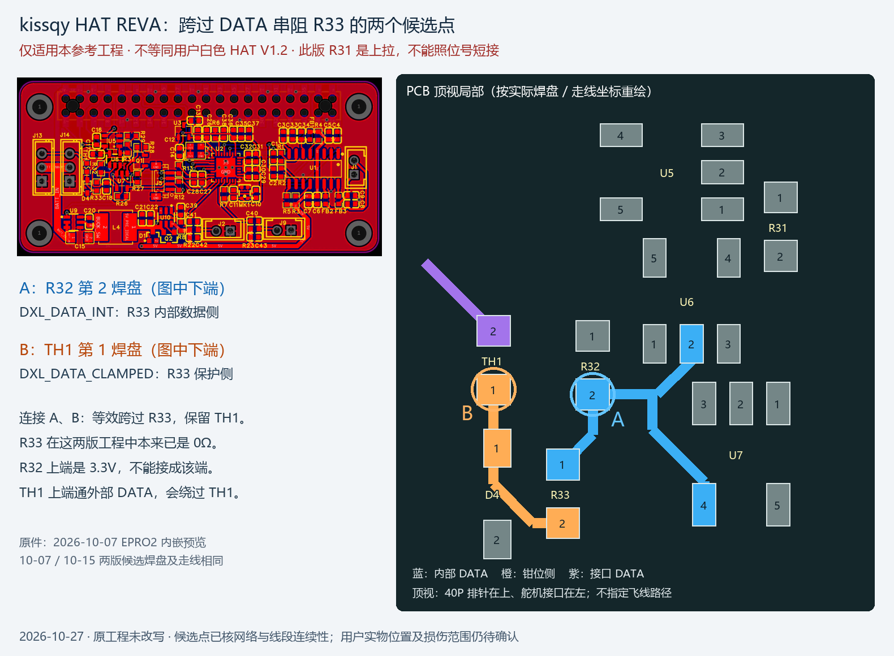

# HAT R31 拆除后两侧焊盘脱落：修复分支

日期：2026-10-27（北京时间）。范围：用户先反馈PCB小焊点无法附锡，随后明确：**是HAT板R31两侧；为短接R31先拆下电阻，尝试用锡连两侧未成功，反复操作后两侧焊盘也脱落。** 以下按用户确认的HAT/R31损伤处理，不再把板卡或“是否只是锡层脱落”列作主要未知；细线、过孔与基材的受损范围仍需新近照核对。

**同日指定工程核查**：用户确认此前所说作者是kissqy，并要求从其PCB寻找绕过串阻的两个点。已解析10-07/10-15两版工程，找到 **R32第2焊盘 ↔ TH1第1焊盘**，等效跨过这版的 **R33**；这版R31是另一条接收网络的上拉，不能照位号短接。工程与白色V1.2布局不对应，详见[网络、定位图及实物边界](#kissqy-bypass-points-20261027)。

## 已知与未确认

- **[用户确认]** 当前白色HAT板上的R31已拆下，意图短接；两侧焊盘在反复上锡过程中脱落。尚无成功跨接、修复或上电后结果，不把它登记成“R31已成功短路”。此R31不是此前在板测得100kΩ的IMU R31。
- **[待确认]** 脱落是否连带拉断细线、带走过孔孔环或损伤基材，是否有焊锡桥接到邻近网络；拆下电阻是否保存及原值；实物两侧网络与完整替代焊点的位置；是否已断开全部外接线。
- 本轮没有收到新的图片附件，不存在可归档的受损原图；**受损近照待用户提供/归档**，历史完好照片不能替代当前损伤照片。

## 初步处理建议（不是已完成维修）

先断电、拔外接线，停止在脱落位置反复堆锡、加热或刮线，保留拆下来的电阻。当前优先恢复受损网络；这块HAT恢复和检查前不继续上电做多节点/示波器实验。本轮不指定温度、刮铜范围或未经核准的跨接终点。

| 条件 | 可考虑的修复方向 | 当前限制 |
|---|---|---|
| R31两侧焊盘剥落，但两侧网络仍各有完整可焊节点 | 从两侧分别找同网的可靠焊点，以短绝缘引线和原值电阻恢复连接，或补焊盘后装回电阻 | 示意：原R31一侧网络的完好节点A → 原值R31 → 另一侧网络的完好节点B；不是让用户直接照图接某芯片脚 |
| 两侧只剩细线断头，周边暂找不到可靠焊点 | 显微镜下评估补铜/接线并固定 | 由具备显微焊接能力者操作；不让用户继续用烙铁追烧或刮宽细线 |
| 细线、过孔或基材也受损 | 显微镜下检查，评估补线/补焊盘或板级维修 | 不能仅凭文字承诺修复成功，也不能据此直接判整板报废 |

**[推断]** 用户确认铜焊盘已经掉落后，单纯增加锡/助焊剂无法重建缺失的铜连接；修复可绕开原焊盘，使用两端网络上的完整节点。能否这样做取决于剩余铜线/过孔和连接点，不由“两个焊盘都掉了”自动判不可修。此处不再建议先尝试表面清洁/重新上锡作为主修法。

### 修复与R31短接试验分开

**[原理图证据]** 存档社区HAT V1.0中，内部DATA节点A经R31到节点B，再经F1到外部DATA；R31不是原设计的一段普通铜线。实物为V1.2，旧照片不能确认该器件精确位置与网络，不能把旧图R31=1kΩ或官方另一版R33=150Ω直接指定成本机维修值。来源见[共总线逐网表及图物边界](../hat-imu-shared-bus-20261027/research.md)。

**V1.0脚号补充（同日原图复读）**：R31左侧同网U5第4脚Y、U4第2脚INA及R20下端信号侧；右侧同网F1左端及D3上端阴极。F1右端接CN11/CN12第3脚DATA；R20另一端为3.3V、D3另一端为GND，不能混同。详见[原图连接表](../hat-imu-shared-bus-20261027/research.md#r31-v10-endpoints-20261027)。这是追线候选依据，不是已核实的V1.2焊盘替代位置。

**[工程建议]** 优先恢复原连接与原阻值，再决定是否做改值试验；当前没有证据确认永久0Ω短接能解决原缺答，短接会改变这段串联阻抗。若要做短接对照，也须先明确实物网络、完整替代焊点、验收与恢复路径。不能把接口DATA直接连到主控TX，也不能顺带绕过F1/缓冲器；未确认网络前不给出“某脚接某脚”的接法。

下一项材料：**受损R31的清晰近照，保留周围约5～10mm器件和位号**；如拆下电阻还在，保留并一并拍清。已知道是HAT，不重复询问板卡身份。新照片用于判断剩余走线和候选替代焊点；随后必要的断电通断检查用于确认这些点各属于R31哪一侧及无新增短路，有直接维修判据，不重复既有总线长扫。

维修后若回到原值/原拓扑，可重建原故障对照；若采用不同阻值或飞线改变布局，后续结果必须注明新配置，不能与修前窗口混算。原多节点缺答发生在此次拆焊之前，新损伤不能反过来解释此前故障。

## 来源与验证状态

- 本机情况：本轮两次用户文字反馈，后一次明确HAT、R31拆除和两个焊盘脱落。无受损照片，无新增本机测量。
- 已取得并读取 CircuitRework [4.0 导体修复目录](sources/circuitrework-conductor-repair.html)：包含4.2.4表面飞线、4.4起翘焊盘、4.5缺失焊盘和4.7贴片焊盘重建，支持“焊盘丢失仍可能修复”。另读[4.5.1通孔焊盘环氧修复](sources/circuitrework-pad-repair.html)：Outline及Procedure强调替换铜箔、清洁/助焊剂、基材处理及电气连接；该页为通孔焊盘方法，不能当本机未知贴片焊点的直接操作步骤。相邻`.txt`为可检索提取件，原HTML保留。
- 前轮`web.run`搜索与打开均未返回可读正文，随后直接下载上述两页成功；Chemtronics飞线修复页读取超时，未用其正文作依据。本轮补充尝试打开`https://www.circuitrework.com/guides/4-2-4.html`仍无可读返回，沿用已归档目录和修复原件，不伪称读过这篇具体步骤。URL、取得状态和SHA-256见[source-manifest.json](source-manifest.json)。网页证据说明有修复方法，不确定本机受损程度。
- 本节是修复可能性与下一步材料清单，不是本机故障确诊、接线许可或维修验收。原IMU通信问题仍待示波器分段定位；新焊点损伤应先明确，避免与原多舵机缺答原因混为一谈。
- 未操作设备、未焊接、未提交/推送。

<a id="kissqy-bypass-points-20261027"></a>

## kissqy PCB：可绕过R33的两个参考点

日期：2026-10-27。本次用户明确指定`kissqy/Microduck-kissqy`，不是新增猜测作者；但用户未确认手中白色V1.2就是此设计。任务为读取PCB网络、找替代焊点并标注，没有实施短接。

### 工程证据与具体点

**[设计文件]** 检查[10-07工程](../../schematics/kissqy-hat-reva-reference/ProPrj_HAT_REVA_SCH_2026-10-07.epro2)与[10-15工程](../../schematics/kissqy-hat-reva-reference/ProPrj_HAT_REVA_SCH_2026-10-15.epro2)的`HAT_REVA_SCH.epru`，PCB UUID均为`9d00f144890fd6bb`；逐项核对组件位号、`PAD_NET`、封装PAD编号/几何及实际LINE走线。两版关键点坐标和网络一致。

| 参考点 | 确定的端点 | 网络 / 与R33关系 | 顶视定位 |
|---|---|---|---|
| **A** | **R32第2焊盘** | `DXL_DATA_INT`，有完整顶层走线接R33第1焊盘，也接U6 pin2/U7 pin4 | 40P在上、舵机接口在左的工程视图中，为R32下端；其上端pin1为3V3 |
| **B** | **TH1第1焊盘** | `DXL_DATA_CLAMPED`，有完整顶层走线接R33第2焊盘，也接D4 pin1 | 同一视图中为TH1下端；其上端pin2为外部`DXL_DATA` |

**[推断，基于已核PCB连线]** 如果只跨过本工程R33，把A和B连接即可；这保留TH1在外部DATA路径中，不需要依赖R33原焊盘。两点中心相距约2.54mm，按PCB坐标mil换算：`sqrt((775.002−675)^2 + (−759.66+754.66)^2) × 0.0254`，不是实物测量，也不是规定飞线长度或布线路径。

```text
R32 pin2 / U6 pin2 / U7 pin4
           │
     DXL_DATA_INT ── R33 (0Ω) ── DXL_DATA_CLAMPED ── TH1 ── DXL_DATA
           A                              B                    接口
                                      TH1 pin1
```

**两版工程中的R33已经标0Ω。** 因而对完好的kissqy成品，再并联导线只是重复原有连接；这项研究回答焊盘损坏后的替代点选择，不证明白板改0Ω能解决原来的缺答。原作者时间线的R33=0Ω/TH1实板调试记录属于其板卡，不能直接升级为本机验证。

### 特别需要防止的位号混用

| 功能 | 白板V1.0参考原理图 | kissqy REVA PCB |
|---|---|---|
| DATA串联电阻 | R31=1kΩ | **R33=0Ω** |
| 内部DATA上拉 | R20=10kΩ | **R32=10kΩ** |
| 串联保护件 | F1 | **TH1** |
| 数据钳位二极管 | D3 | **D4** |
| 接收缓冲/发送缓冲 | U4 / U5 | **U6 / U7** |

**[设计文件] kissqy R31不是DATA串阻**：它为10kΩ RX上拉，pin1接`3V3`，pin2接`TTL_RX_RAW`。短接这版R31会直接连接3V3与接收缓冲输出网络，并非用户要做的DATA串阻旁路，不作为候选操作。A应选R32信号端，不能误选R32的3V3端；B应选TH1内侧，不能误选接口侧同时绕过TH1。

### 生成图与图物对应



- 标注图左侧为10-07工程内嵌原始预览；右侧按PCB绝对坐标、器件旋转与原始封装PAD重绘同区域，绘出三条DATA网络的顶层走线、针号、A/B框选。仅重绘本任务相关器件/网络，不是全层制造文件或实际飞线路径。
- 原预览另存[10-07](../../schematics/kissqy-hat-reva-reference/pcb-preview-2026-10-07.webp)、[10-15](../../schematics/kissqy-hat-reva-reference/pcb-preview-2026-10-15.webp)，都是EPRO2原件内提取，未通过照片猜测布局。两张已打开对照；10-15增加指示灯及改变接口，候选网络区域保持一致。
- 生成脚本：[inspect-kissqy-hat-bypass-20261027.py](../../../scripts/inspect-kissqy-hat-bypass-20261027.py)。初版图例与D4附近重叠，已移动图例、增高画布并重新生成/打开检查；最终A/B圈均包围对应焊盘，未遮住编号。
- **[照片对照]** 既有[白色HAT V1.2背面原照](../../photos/hat-v1.2-back.jpg)的器件布局与该REVA预览不一致；没有取得受损R31近照，因此不能把此图R32/TH1位置直接标成本机焊点，也不能将用户指定作者当作确认板型。下一步若要实际维修白板，仍需在其受损局部追踪相应两端，并在断电下确认候选点；不继续依靠旧照片猜位置。

### 来源、解析与验证

- 上游固定提交`7c5fba929e668aab4fa86f608fb7586c0e9718b2`，目录`https://github.com/kissqy/Microduck-kissqy/tree/7c5fba929e668aab4fa86f608fb7586c0e9718b2/hardware`；原件来源及SHA-256见[工程入口](../../schematics/kissqy-hat-reva-reference/README.md)。本次校验原件哈希与归档值一致，没有修改参考工程。
- 本轮`web.run`打开GitHub的hardware目录无可读返回；使用已下载固定版本，不宣称本次核验了最新main。来源定位为压缩包内文件/记录行号，完整证据见[kissqy-bypass-evidence-20261027.json](kissqy-bypass-evidence-20261027.json)。
- 10-07：A的PAD_NET位于epru第8868行，B第8881行，R33两端第8874/8875行；10-15对应9231、9244、9237/9238行。封装pad id及换算后坐标已记录。
- 初次把全部记录体当JSON解析，遇到空体删除记录失败；后续按文档/对象id回放更新并处理删除记录，最终证据不含已删除对象。探索阶段全PCB导出仅为临时中间件，最终保留紧凑证据与可复现脚本，不保留重复全量导出。
- 按网络和顶层LINE建立端点连通图，A→R33 pin1、B→R33 pin2均连通；坐标归并精度0.01mil。此检查针对该段现有走线，不冒称全板DRC、元器件实测或用户焊盘连通实测。两版候选点几何/网名一致检查通过。
- 未改变线路、焊接、刷机、上电、提交或推送；原缺答根因仍待实物修复后的对照。
