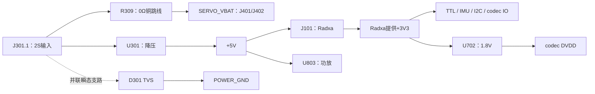

# 自设计HAT电源接口与保护范围

本页针网保持原定义；**2026-11-02当前源9daf71d8将J301改为B面插接**，见[机械修复](../../归档扩展板机械适配复核/research.md)和[Rev A.1入口](../../../../hardware/custom_hat/rev_a/README.md)。**不是白色V1.2实物接线图**。以下为文件核对；用户确认尚未送厂、没有新板实物，制造后按[A.1草案](../../../specs/20261028-custom-hat/first-article-a1.md)验收。

## J301针序

保持40P排母孔在图上方、J301在下方：**从B面插接端看，J301从左到右1、2、3、4、5、6、7、8，pin1在左端；从F面焊尾端看则为8→1，pin1在右端。** B面现有“1:2S+”“2:GND”及pin1标记；数字和网络优先，禁止跨视角照搬左右。见[当前针序图](../../归档扩展板机械适配复核/j301-and-spacing.png)。

| 针 | 网络 | 设计用途与边界 |
|---|---|---|
| 1 | VBATT_2S_IN | 2S输入正极，对应2S+；本板没有反接阻断 |
| 2 | POWER_GND | 输入回地，对应GND |
| 3 | +5V | Buck输出/调试节点，不作第二电源入口 |
| 4 | +3V3 | 来自主控Radxa的3.3V节点，本板没有独立3.3V稳压源 |
| 5 | NC | 不接 |
| 6 | +1V8_CODEC | U702产生的codec电源/调试节点，未分配额外外设供电预算 |
| 7 | SERVO_VBAT | 经R309铜跳线的电池直通支路，未独立限流，不作另一路电源输入 |
| 8 | POWER_GND | 地节点；允许电流/回路需按实际线束核对 |

这些引脚不是8针统一电压接口。不能将5V、3.3V、1.8V、SERVO_VBAT等节点并联或反向灌电源。具体实装/插接仍须核极性和针序。

## 电源关系

下图为功能电源树，不是逐根接线施工图。

只给空板接2S时，不应预期它独立产生正常3.3/1.8V；漂浮/残余电压不能当这两轨验收。基础5V轨与插接极性核对的边界不因此改变，本轮没有操作实物。

## 保护职责

| 项目 | 当前实际范围 |
|---|---|
| U301过流/过温/欠压功能 | 芯片及5V降压支路，不能保护旁路的SERVO_VBAT全部路径 |
| R309 | 铜跳线，不是保险或电子限流器 |
| D301 | 并联TVS用于瞬态处理，不是串联反接阻断、持续过流保护或电池BMS |
| 2S欠压截止 | 本板未设置专用电池截止；不能把U301自身UVLO当2S电池保护 |
| 外部电源/线束 | 保护能力、配对接头和电流条件尚未核准；不得借单个器件额定标整板额定 |
| USB/HAT并供 | 当前设计不支持；相关网络在所核Radxa图中相连，不能仅凭关电池就认定不会反向供电 |

现有v2执行决定与历史白色HAT不因本文自动变更；没有新增采购/接线指令，也没有把未测风险判成已经发生的故障。制造与上电放行仍看当前[审查记录](research.md)。
